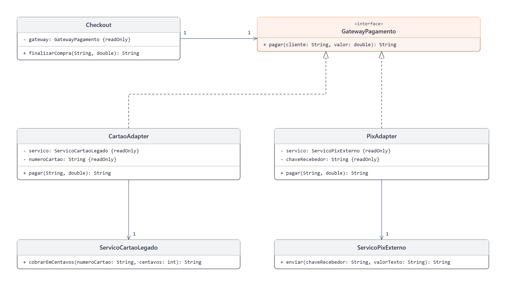

# DCC078 - Padrões de Projeto: Adapter

**Aluno:** Felipe Lazzarini Cunha

## Tema

O projeto representa o fechamento de uma compra em uma loja virtual que precisa aceitar pagamento por cartão e por Pix, serviços com interfaces incompatíveis com a esperada pelo sistema. O Adapter converte a interface de cada serviço para `GatewayPagamento`, de modo que o checkout não dependa de nenhum deles. As cobranças são simuladas por mensagens de texto.

## Diagrama de Classes UML



## Estrutura do Projeto

- `GatewayPagamento`: interface alvo esperada pelo cliente.
- `ServicoCartaoLegado` e `ServicoPixExterno`: classes existentes com interfaces incompatíveis.
- `CartaoAdapter` e `PixAdapter`: adaptadores que convertem os parâmetros e delegam ao serviço adaptado.
- `Checkout`: cliente que finaliza a compra usando apenas `GatewayPagamento`.

## Testes

Com JDK 11 ou superior e Maven:

```bash
mvn test
```
